<div align="center">

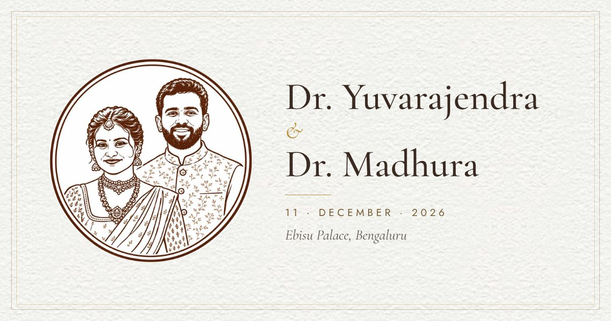

# Dr. Yuvarajendra & Dr. Madhura

**An interactive wedding invitation · Bengaluru · 10–16 December 2026**

[**Open the invitation →**](https://YOUR-GITHUB-USERNAME.github.io/YOUR-REPO-NAME/)

<br>

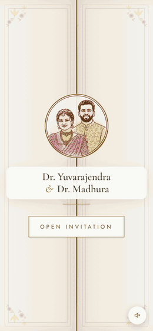

</div>

---

## About

A single-page wedding invitation made to be opened on a phone and shared on WhatsApp. It opens like a pair of palace doors, plays a veena rendition of *Paruvam Vanaga*, and walks guests through the celebrations one full screen at a time. The painted temple, banana plant and garlands sway gently behind every screen.

## The celebrations

| | Event | When | Where |
|---|---|---|---|
| 🪔 | **Reception** · Celebration & dinner | Thursday, 10th December 2026 · 7:00 pm onwards | Ebisu Palace |
| 🏺 | **Muhurtham** · Auspicious wedding ceremony | Friday, 11th December 2026 · 12:05 – 12:45 pm | Ebisu Palace |
| 🍃 | **Bheegara Oota** · Grand wedding feast | Wednesday, 16th December 2026 · Lunch from 12:30 pm | Ebisu Studio |

All three are at **EBISU Convention Center**, Hegde Nagar Main Road, Chokkanahalli, Bengaluru 560064.

## A walk through the screens

<table>
  <tr>
    <td align="center">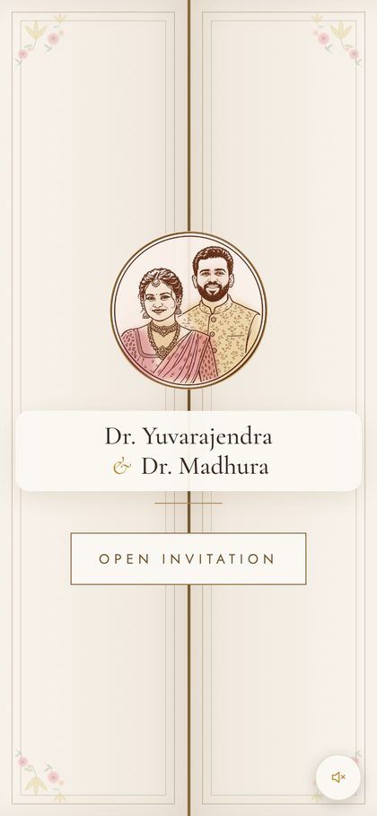<br><sub><b>The doors</b><br>Tap to open; the music begins</sub></td>
    <td align="center">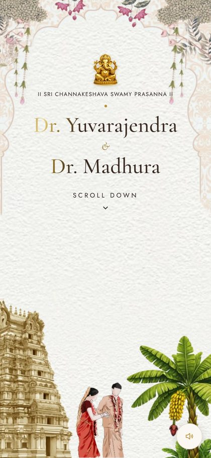<br><sub><b>Blessings</b><br>Names in shimmering gold foil</sub></td>
    <td align="center">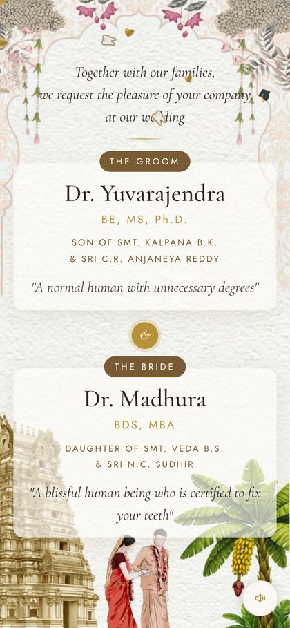<br><sub><b>The couple</b><br>Gold hearts, 🎓 and 🦷</sub></td>
  </tr>
  <tr>
    <td align="center">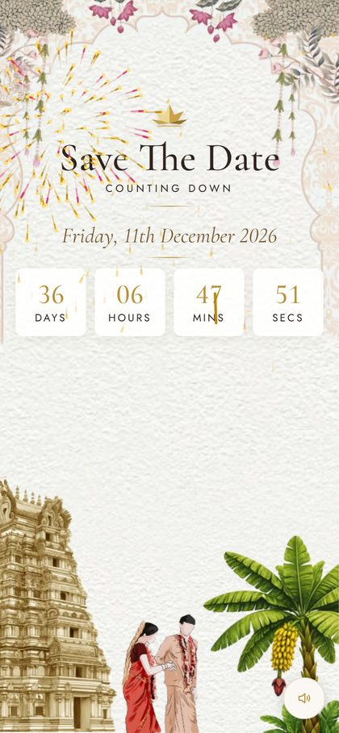<br><sub><b>Save the date</b><br>Tap to reveal, and the rockets burst</sub></td>
    <td align="center">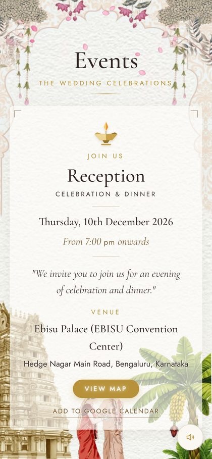<br><sub><b>Reception</b><br>Rose petals</sub></td>
    <td align="center">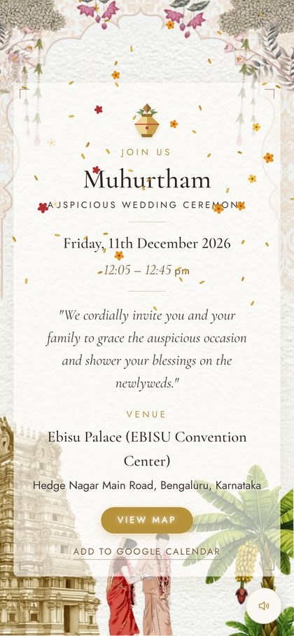<br><sub><b>Muhurtham</b><br>Turmeric rice (akshate) and flowers</sub></td>
  </tr>
  <tr>
    <td align="center">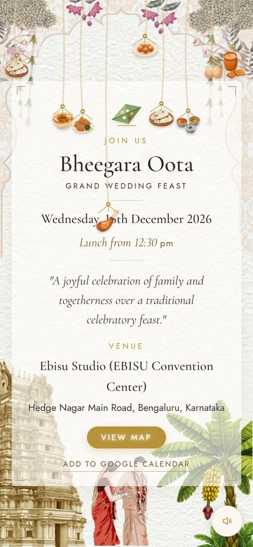<br><sub><b>Bheegara Oota</b><br>The feast on ropes. Keep it up!</sub></td>
    <td align="center">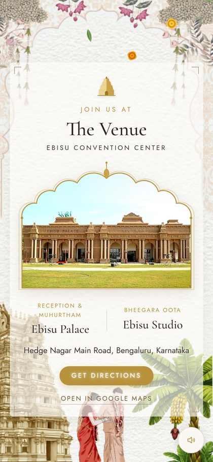<br><sub><b>The venue</b><br>Mango leaves and marigolds</sub></td>
    <td align="center">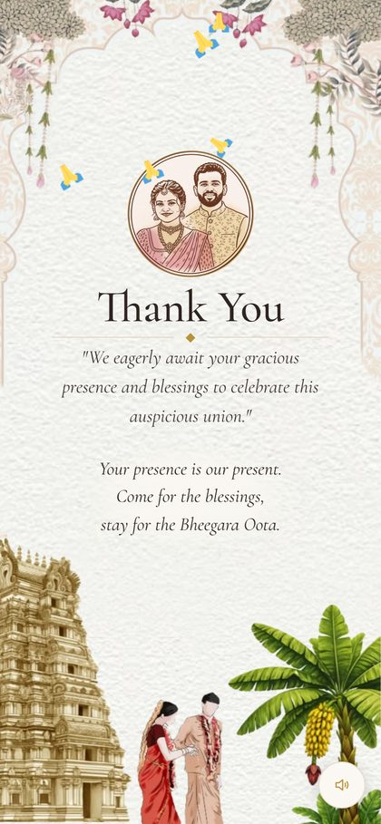<br><sub><b>Thank you</b><br>🙏</sub></td>
  </tr>
</table>

## Little things guests will notice

- **Opening doors:** the invitation starts behind carved doors that swing open on a tap, starting the music.
- **A living background:** garlands swing, the banana plant sways in the breeze, and the temple and couple drift slowly.
- **One screen per swipe:** every swipe lands cleanly on the next screen, and each screen resizes to fit small phones.
- **A shower for every screen:** each screen has its own shower that keeps going while you stay, from rose petals and yellow akshate rice to firecrackers that only burst after the date is revealed.
- **The feast game:** dishes hang on twisted ropes, slip below the title one by one, and get yanked back up.
- **Shake your phone:** the shower on the current screen gets heavier for a few seconds.
- **Live countdown:** it counts down to the Muhurtham at 12:05 pm IST.
- **Add to calendar:** each event adds to Google Calendar in one tap, or to Apple and Outlook calendars from a calendar file.
- **Directions:** one tap opens EBISU Convention Center in Google Maps.
- **WhatsApp-ready:** a shared link shows the couple's portrait as the preview card.

## Under the hood

- One `index.html` file, written in plain HTML, CSS and JavaScript, with no frameworks and no build step.
- About 1 MB in total, including the music, so it loads quickly on mobile data.
- **Showers:** they are drawn on a single canvas. Every piece is pre-drawn once and only placed on screen each frame.
- **Smooth on cheaper phones:** the page uses fewer pieces on low-end phones and thins the shower further if frames start to drop. In testing it holds 50–60 fps with the processor slowed to a quarter of its speed.
- **Reduced motion:** the animations switch off for anyone whose phone is set to reduce motion.

```
index.html           the whole invitation
bg/                  artwork, food illustrations, song, calendar files, preview image
docs/                screenshots and the demo used in this README
```

To preview locally, open `index.html` in a browser. For the full experience, including the calendar downloads, serve the folder:

```bash
python3 -m http.server 8000   # then visit http://localhost:8000
```

To host it, enable **Settings → Pages → Deploy from a branch → `main` / root**. Replace `YOUR-GITHUB-USERNAME` and `YOUR-REPO-NAME` in `index.html` (the `og:url` and `og:image` tags) and in the link at the top of this README.

## Credits

- **Music:** *Paruvam Vanaga / Pudhu Vellai Mazhai* (A. R. Rahman), live veena performance by Veena Srivani.
- **Emoji graphics:** 🙏 🎓 🦷 from [Twemoji](https://github.com/jdecked/twemoji) by Twitter/X and contributors, used under CC-BY 4.0.
- **Typefaces:** [Cormorant Garamond](https://fonts.google.com/specimen/Cormorant+Garamond) and [Jost](https://fonts.google.com/specimen/Jost) from Google Fonts.
- **Artwork:** the background illustration, couple portrait, Ganesha emblem, venue photograph and food illustrations were supplied by the couple.

<div align="center">
<br>

*Your presence is our present.<br>Come for the blessings, stay for the Bheegara Oota.*

</div>
